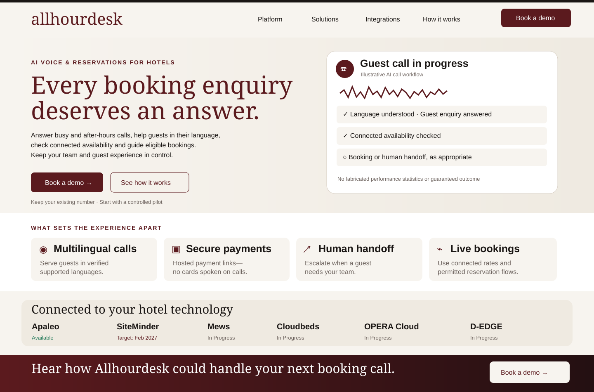

# Allhourdesk — Website Content V2
**Version:** 2.0 • **Date:** 21 November 2026  
**Status:** Proposed production copy + UX specification; product/legal approval gates apply  
**Primary persona:** Hotel owner / general manager / commercial or revenue director  
**Secondary:** Front-office manager; hotel IT / reservations systems owner  
**Objective:** Convert relevant hotels into demos and controlled pilots, starting with Apaleo properties while maintaining platform-neutral positioning.

> This is the **content source for the V2 website**, not an instruction to publish unverified capabilities. It supersedes earlier *marketing website wording*, not product scope or contracts. For technical boundaries see [product-scope-v1.md](../product-scope-v1.md); for GTM see [MARKETING_STRATEGY.md](../MARKETING_STRATEGY.md). The [existing content draft](../website%20content/WEBSITE_CONTENT.md) is retained as background. Visual and component rules come from [DESIGN_SYSTEM.md](../website%20design%20assets/DESIGN_SYSTEM.md) and [COMPONENTS.md](../website%20design%20assets/COMPONENTS.md).

---

# A. Strategy translated into a website

## A1. The single buying decision

An owner arriving at the site should understand this within 10 seconds:

**Problem:** Hotels lose booking-ready conversations when a receptionist is busy or unavailable.  
**Solution:** Allhourdesk uses AI to answer appropriate hotel calls, provide approved information and guide eligible guests through connected reservations and secure payment.  
**Adoption:** The hotel can evaluate the product through a controlled pilot and keep its existing customer-facing phone number.  
**Proof:** A genuine call-to-reservation demo, verified integration details and measured outcomes.  
**Action:** Book a demo / discuss a pilot.

The site is **not** a consumer booking marketplace and should not claim access to an unproven pool of traveller demand. Revenue improvement is an outcome hypothesis to validate, not a guarantee. Do not lead with hourly/day-use stays; not in the V1 specification.

## A2. Positioning choices

**Category:** AI Voice & Reservations for Hotels.  
**Brand proposition:** *Every booking enquiry deserves an answer.*  
**Commercial benefit:** Capture more opportunities from calls your team cannot always answer.  
**Product explanation:** Hotel-specific AI handles guest conversations and supports new reservations using connected availability, rates, booking rules and hosted payment workflows.  
**Control message:** Your team, phone identity, connected systems and approved policies stay in control.  
**Integration position:** A growing, multi-integration platform. Apaleo is first in acquisition, **not** the whole brand.  
**Tone:** Calm, factual, premium, warm; no “magic AI,” hype, false scarcity or made-up conversion uplift.

### Headline candidates (choose one during design testing)

1. **Every booking enquiry deserves an answer.** — **Recommended**: most owner-relevant and understandable.
2. **The calls you miss could be bookings you keep.** — More commercial, needs careful no-guarantee context.
3. **Your front desk can be busy. Your hotel phone doesn't have to be.** — Operational and friendly.

Do **not** lead with “Your night manager never sleeps.” Retain this as an after-hours campaign line, not the entire category. Do **not** lead with a generic “More revenue from your rooms” without explaining call-to-booking mechanics.

## A3. Persona and objection map

| Visitor | They want to know | On-page answer and evidence |
| --- | --- | --- |
| Owner / GM | Will this recover booking value without adding staff or risk? | Call capture, controlled pilot, plausible live-call demo, real hotel results when available |
| Revenue manager | Are rates, restrictions and booking ownership respected? | Connected real-time lookup, booking terms, no invented prices; eligible Allhourdesk-originated reservation scope |
| Front office lead | Will it disrupt team workflows or steal calls? | Forward-on-no-answer / selected hours, human fallback, existing number, call handover |
| IT / PMS lead | Will this integrate securely and reconcile correctly? | Provider-specific capability list, production checks, payment ownership and fail-safe outcomes |
| Group buyer | Can we pilot and expand responsibly? | Stepwise rollout and property-specific configuration; multi-property features only if verified |

## A4. New sitemap and conversion routes

| Page | URL proposal | Goal | Primary CTA |
| --- | --- | --- | --- |
| Home | `/` | Communicate benefit, product, confidence | Book a demo |
| How it works | `/how-it-works` | Explain the call-to-booking journey without a wall of diagrams | Hear a demo |
| AI reservations | `/platform/reservations` | Establish actual transaction boundary | Discuss a pilot |
| Call coverage | `/solutions/call-coverage` | Sell no-answer, after-hours and overflow | Book a demo |
| Guest enquiries | `/solutions/guest-enquiries` | Explain knowledge and multilingual support honestly | Hear a demo |
| Integrations | `/integrations` | Show platform compatibility and honest roadmap | Explore Apaleo / Request integration |
| Apaleo | `/integrations/apaleo` | Convert the first ICP cohort | See Apaleo demo |
| Trust | `/trust` | Remove payment, AI, data and operational anxieties | Discuss your setup |
| Pilot / onboarding | `/pilot` | Lower implementation risk | Apply for a pilot |
| Company | `/about` | Establish authentic supplier credibility | Meet the team / Contact |
| Demo / contact | `/demo` | Capture lead with low friction | Request my demo |
| FAQ | `/faq` | Resolve buying objections | Book a demo |

**MVP launch pages:** Home, How it works, Integrations, Apaleo, Pilot, Trust, Demo; lightweight sections/pages for other solutions can follow. The technical product diagram belongs **below the commercial story** on How it works, with a link for technical evaluators.

## A5. Global navigation and conversion

**Desktop navigation:** Allhourdesk | Platform ▾ | Solutions ▾ | Integrations | How it works | Trust | Company ▾ | **Book a demo**.  
**Mobile:** clear logo, menu, persistent Book a demo.  
**Global secondary CTA:** “See how it works” or “Hear a demo,” never four competing primary buttons.  
**Navigation target:** Target all visitors, not just Apaleo accounts. Apaleo-specific UTM links land on `/integrations/apaleo`.

**Every major page** contains: specific owner-centred H1; short supporting copy; believable product evidence; low-risk adoption; clear CTA; one or two FAQs. No invented logos, testimonials, certifications, integrations or metrics.

---

# B. Production-ready page copy

The quoted headings and paragraphs below are **copy candidates ready for design**, subject to the claims gates in Section D. Bracketed stage directions are implementation instructions, **not literal website text**.

# B1. Homepage — `/`

**SEO title:** Allhourdesk | AI Voice & Hotel Reservations  
**Meta description:** Help your hotel answer missed booking calls, respond to guest enquiries and turn eligible conversations into reservations using connected hotel systems. See Allhourdesk in action.  
**Primary goal:** Demo requests from owners / GMs / revenue managers.  
**Hero visual:** actual or clearly labelled *illustrative* conversation and transaction journey, not a generic architecture graph.

### Section 01 — Hero (above the fold)

**Eyebrow:** AI VOICE & RESERVATIONS FOR HOTELS

# Every booking enquiry deserves an answer.

**Body:** Your front desk cannot answer every call. Allhourdesk helps your hotel respond when the team is busy or unavailable, answer guest questions and guide eligible callers towards a reservation using live connected information.

**Primary CTA:** Book a demo  
**Secondary CTA:** See how it works

**Microcopy:** Keep your existing hotel number. Start with a controlled pilot.

**Hero product-state visual / storyboard (illustrative until verified):**  
Incoming guest call → “Do you have a double room for Friday?” → availability checked → valid rate presented → secure payment link sent → reservation confirmed (or *needs attention* state if completion fails). Include a modest caption “Illustrative workflow. Availability and booking actions depend on the connected system and hotel configuration.” A real recorded demo should replace it as soon as approved.

### Section 02 — Problem and benefit

**Eyebrow:** THE OPPORTUNITY

## Your team cannot be everywhere. Your guests still expect an answer.

During check-in, late at night or while helping someone at the desk, the next guest call can be the one no one picks up. That might be a simple question—or a guest ready to book.

**Card 1 — Calls after hours:** Help guests who call when the reception desk is not staffed.  
**Card 2 — Front-desk overflow:** Give busy teams room to serve guests already at the property.  
**Card 3 — Reservation enquiries:** Help booking-ready callers move from a question to a valid room option.  
**Card 4 — Everyday questions:** Answer approved questions about breakfast, parking, arrival and hotel policies.

**Short reinforcing line:** More answered conversations. More chances to earn the booking. Your team stays in control.

### Section 03 — Outcome before technology

**Eyebrow:** WHAT ALLHOURDESK DOES

## It is more than someone taking a message.

Allhourdesk is designed to carry a guest conversation into a useful next step: a reliable answer, an eligible booking workflow or a clear handover when human assistance is needed.

**Three proof pillars:**  
**Answer:** Natural hotel-focused phone conversations and property information grounded in approved sources.  
**Book:** Check connected availability, rates and restrictions for new reservation enquiries.  
**Follow through:** Guide guests to a secure hosted payment step and an appropriate booking outcome, with exceptions surfaced rather than hidden.

**Link CTA:** Explore the reservation journey

### Section 04 — How it works (simplified journey)

**Eyebrow:** FROM CALL TO OUTCOME

## A booking enquiry should not end at voicemail.

1. **Guest calls your hotel.** Calls can be forwarded according to the route agreed for your pilot.
2. **Allhourdesk understands the request.** It answers approved questions and identifies new reservation intent.
3. **Live availability is checked.** Valid rooms, rates and applicable restrictions come from a connected authorised source.
4. **The guest gets a secure next step.** Where supported, the payment and reservation flow moves forward with clear status.
5. **A confirmed result—or an escalation.** The workflow only confirms a booking when the required system and payment conditions are satisfied.

**CTA:** See how a reservation works

*Detailed hold / payment / cancellation branches should appear on How it works, with provider-specific caveats. Do not say every integration supports provisional holds or automatic release.*

### Section 05 — Low-friction adoption

**Eyebrow:** DESIGNED AROUND YOUR OPERATION

## Keep your number. Keep your people. Add coverage where it helps.

Your existing front desk remains the heart of the guest experience. Start by routing selected unanswered or after-hours calls to Allhourdesk. Test scenarios first, verify the connection and extend coverage only when your team is ready.

**Bullets:** Existing published number can remain in place with supported forwarding; configurable pilot coverage; validated availability and booking permissions; a clear fallback when the AI cannot complete a task.

**CTA:** Plan a pilot

### Section 06 — Integrations (balanced and transparent)

**Eyebrow:** WORKS WITH YOUR HOTEL TECHNOLOGY

## Connected where it counts. Expanding where hotels need us next.

Allhourdesk is designed to connect guest conversations with the reservation and payment systems hotels already use. Check what is available today and what is still being developed.

**Integration cards:**
- **Apaleo — Available** (verify tested capabilities before “ready to activate”).
- **SiteMinder — Target: February 2027** (date is a planning target, not guaranteed launch).
- **Mews — In Progress.**
- **Cloudbeds — In Progress.**
- **Oracle OPERA Cloud — In Progress.**
- **D-EDGE — In Progress.**

**Under cards:** “In Progress integrations are not currently available for activation. Compatibility and available actions vary by system.” If an integration is not actually under active development, change the status to **Planned**.

**Primary link:** Explore integrations  
**Secondary link:** Don't see your system? Tell us what you use.

**Design:** Apaleo status badge visibly distinct; not six identical “connected” logos. Never imply an official vendor partnership with unauthorized branding.

### Section 07 — Measurable value, no made-up ROI

**Eyebrow:** SEE WHAT YOUR HOTEL CAN MEASURE

## Start with a test. Let real calls tell the story.

The most useful proof isn't a projected percentage. It's seeing an actual enquiry handled, a valid room option returned and a reservation workflow completed correctly.

**Pilot measurement cards:** Calls routed; calls handled; booking-intent calls; test reservations; confirmed reservations; exceptions requiring your team. Show actual values **only** after implementation and tracking validation. Until then, make these a “What we measure” list, not dashboard screenshots masquerading as real results.

**CTA:** See the pilot process

### Section 08 — Trust (short)

**Eyebrow:** HOTEL CONTROL COMES FIRST

## Intelligent conversations. Clear operational boundaries.

Rates and restrictions come from connected sources. Guests can be directed to secure hosted payment pages instead of speaking card numbers. When a system cannot complete an approved action, Allhourdesk should explain the next step rather than invent an answer.

**Three trust items:** Real connected data; controlled payments; human escalation.

**Link:** How we approach trust and security

### Section 09 — Objection FAQs (accordion)

**Can we keep our existing phone number?**  
The recommended pilot starts with configured forwarding, so your published number can remain unchanged where your phone provider supports it.

**Will Allhourdesk replace our reception team?**  
No. It is designed as complementary coverage for appropriate calls, with human handling and escalation for cases that need your staff.

**Will Allhourdesk work with our PMS or channel manager?**  
See the current integration status list. Apaleo is the initial available connection; other systems have separate readiness statuses. Supported actions vary.

**Can it change any booking already in our system?**  
Not in V1. Changes and cancellations are limited to eligible Allhourdesk-originated reservations where connected systems and booking terms permit them. Other bookings are escalated or redirected.

**How quickly can our hotel go live?**  
The timeline depends on the connection, payment verification, phone setup and end-to-end tests. We confirm a realistic activation plan during discovery.

### Section 10 — Final conversion band

# See what happens when your hotel answers the next booking call.

Bring a typical guest scenario and your current reservation system. We'll walk through how Allhourdesk could fit your operation.

**CTA:** Book your hotel demo  
**Secondary:** Explore the pilot

---

# B2. How it works — `/how-it-works`

**SEO title:** How Allhourdesk Works | From Hotel Call to Reservation  
**Meta:** Learn how Allhourdesk handles guest calls, checks connected availability, supports secure payment and follows safe booking rules.  
**Hero H1:** From a phone call to a useful hotel outcome.  
**Lead:** The guest wants an answer. The hotel needs accuracy and control. Allhourdesk brings the conversation and the booking workflow together.

### Buyer-first summary: three stages

**1. Answer the call.** The hotel decides when calls are routed. Allhourdesk identifies intent and uses approved property information.  
**2. Check and guide.** For a new booking request, it looks up valid availability, rates, restrictions and supported booking actions.  
**3. Confirm or escalate.** Only complete the reservation when the required payment, system and booking conditions are met. Otherwise follow the agreed exception route.

### Product proof section

## What happens when a caller wants to book?

Show a **realistic, interactive or recorded product walkthrough** in human language, with five progressive states:
- “I need a room for Friday night.”
- “Here are the room options available for your dates.”
- “The guest selects a room and sees the booking terms.”
- “A secure payment link is offered where configured.”
- “The final reservation status is verified and shared.”

Add a note: *A temporary hold, a release deadline, cancellation and refund capabilities depend on the connected provider and configured workflow. Do not claim that every system can hold inventory.*

### Behind the scenes — collapsed advanced section

**Heading:** The technology matters. Here is where we use it.

Describe reservation lookup, restrictions, provisional hold **only where supported**, payment state reconciliation, confirmation, release/timeout or operational escalation. Preserve the valuable original `product.html` hold → pay → confirm/release diagram as an **optional technical deep dive**, but fix:
- blanket assumption that holds always exist;
- global “CANCEL any existing booking” impression;
- unconditional “confirmed written to PMS” route for every integration;
- “simulated hold” as an unconditional protection against overselling.

**Technical CTA:** Ask about your reservation workflow.

### Existing number

**Heading:** Your existing hotel number can stay where it is.  
**Copy:** Start with limited call forwarding where supported. Your team answers first, and Allhourdesk handles the agreed no-answer or after-hours cases. Routing details depend on phone provider and country.

### FAQ
What if the rate is unavailable? What if payment fails? What if the caller changes their mind? Which bookings can be amended? When does a person intervene? Each answer should demonstrate explicit workflow states, rather than overpromising automation.

**Final CTA:** Hear Allhourdesk handle a hotel call.

---

# B3. AI reservations — `/platform/reservations`

**SEO title:** AI Hotel Reservations | Allhourdesk  
**Hero H1:** Help booking-ready callers get to a real reservation.  
**Lead:** Move beyond a missed call or a message for tomorrow. Allhourdesk is designed to check connected inventory, present valid options and support new reservations within the hotel's approved rules.

### Feature cards
**Live availability:** Look up dates, occupancy, rooms and rates from a permitted connection.  
**Booking rules:** Respect restrictions, policies and the guest's selected terms.  
**Secure payment:** Offer hosted payment steps when configured; do not ask guests to read card details aloud.  
**Clear outcome:** Verify booking status and surface exceptions that require attention.

### Booking ownership boundary

**Heading:** The right actions, on the right reservations.  
**Copy:** V1 focuses on new reservations created through Allhourdesk. Supported changes or cancellations to those bookings depend on the provider and booking terms. Reservations made through other channels remain under the appropriate hotel or originating-channel process.

**CTA:** Discuss your reservation flow.

---

# B4. Call coverage — `/solutions/call-coverage`

**SEO title:** Hotel Phone Overflow & After-Hours Call Coverage | Allhourdesk  
**Hero H1:** The front desk can be busy. The phone still needs an answer.  
**Lead:** Protect your team's attention during check-in peaks and offer useful support when reception is unattended.

**Use-case sections:**
- **After-hours:** answer approved guest questions and booking enquiries.
- **Busy front desk:** forward selected unanswered calls so staff can focus on guests in front of them.
- **Selective coverage:** test with a narrow set of hours or conditions before scaling.
- **Safe escalation:** hand off unsupported requests, technical failures or sensitive exceptions.

**Control band:** “Your hotel chooses when to route calls.”  
**CTA:** See a call-coverage demo.

---

# B5. Guest enquiries — `/solutions/guest-enquiries`

**SEO title:** AI Guest Enquiries for Hotels | Allhourdesk  
**Hero H1:** The right hotel answer, whenever someone calls.  
**Lead:** Use approved property information to answer recurring questions consistently while keeping complex decisions with your team.

**Examples:** check-in/check-out times (information only), parking, breakfast, pets, directions, late arrival guidance, cancellation policy explanations, amenities and local property instructions.

**Critical boundary:** Explaining an early-check-in policy is **not** executing early check-in in the PMS. Never imply arbitrary operations or exceptions can be approved autonomously.

**Language section:** “Speak naturally; supported languages are verified for each deployment.” Publish a language list only after tested quality sign-off. Avoid “all languages.”

**CTA:** Test a guest enquiry.

---

# B6. Integrations — `/integrations`

**SEO title:** Hotel PMS & Channel Manager Integrations | Allhourdesk  
**Hero H1:** Your hotel systems. Connected to better guest conversations.  
**Lead:** Allhourdesk is built to work alongside the tools hotels trust for reservations and operations. Explore available connections and our expansion roadmap.

### Status-based integration catalogue

| Name | Category | Exact UI status | CTA |
| --- | --- | --- | --- |
| Apaleo | PMS | **Available** | Explore Apaleo |
| SiteMinder | Channel manager | **Target: February 2027** | Request launch update |
| Mews | PMS | **In Progress** | Register interest |
| Cloudbeds | PMS | **In Progress** | Register interest |
| Oracle OPERA Cloud | PMS | **In Progress** | Register interest |
| D-EDGE | Channel manager | **In Progress** | Register interest |

**Status note under grid (visible):** “Available connections have a defined onboarding path. In Progress connections cannot yet be activated. The SiteMinder date is a target subject to implementation and partner requirements.” Use “Planned” instead of In Progress when development has not started.

### Architecture explanation in buyer language

**Heading:** One conversation, connected to the right source.  
**Copy:** Allhourdesk retrieves approved hotel information and booking data through authorised connections. Your reservation system remains the relevant system of record; supported operations differ by provider and integration model.

**Categorise clearly:** Direct PMS connection vs channel-manager/distribution connection vs telephony vs hosted payment/messaging. Do not imply all six are interchangeable, or that all support the same reservation actions.

### Integration request form

**Heading:** Don't see your hotel system?  
**Copy:** Tell us what you use and what you want Allhourdesk to handle. We'll share the current compatibility position and record your interest.  
**Fields:** PMS/channel manager; hotel; business email; country; optional use case.  
**CTA:** Ask about an integration.

---

# B7. Apaleo landing page — `/integrations/apaleo`

**SEO title:** Allhourdesk for Apaleo Hotels | AI Calls & Reservations  
**Meta:** Using Apaleo? Explore how Allhourdesk can answer booking calls, use connected reservation data and support a controlled hotel pilot.  
**Goal:** Convert traffic from direct Apaleo-hotel outreach into demo and pilot requests without framing the company as Apaleo-only.

**Eyebrow:** FOR HOTELS USING APALEO

# Your Apaleo-connected hotel deserves fewer missed booking calls.

**Lead:** Allhourdesk helps hotels handle booking enquiries and routine guest questions through AI voice workflows designed to connect with live reservation information. See what your Apaleo setup can support in a guided demo.

**Primary CTA:** See the Apaleo demo  
**Secondary:** Discuss a pilot

**Microcopy:** Apaleo integration available. Specific reservation and payment actions are verified during onboarding.

### Three commercial benefit cards

**Recover unattended opportunities:** Respond to approved booking calls that would otherwise go unanswered.  
**Keep your current operation:** Start with a test and limited forwarding while your front desk stays in control.  
**Prove the workflow:** See connection validation, a realistic call scenario and the booking outcome before wider rollout.

### Section: What an Apaleo pilot looks like

1. **Discovery:** confirm hotel use cases, rate rules, phone routing and Apaleo access.
2. **Connect:** authorise and test the relevant integration permissions.
3. **Configure:** hotel knowledge, booking restrictions, payment path, fallback rules.
4. **Test:** run an end-to-end call and test reservation/payment workflow (where enabled).
5. **Pilot:** route selected live calls after all go-live requirements pass.
6. **Review:** examine actual call, reservation and exception metrics with the hotel.

### Explicit capability table (engineering fills before publication)

| Action | Status |
| --- | --- |
| Property / room and rate lookup | **Verify production behaviour before publish** |
| New reservation creation | **Verify production behaviour before publish** |
| Provisional hold and expiry | **Provider/workflow dependent** |
| Payment link and payment status | **Verify selected hotel payment configuration** |
| Amend/cancel Allhourdesk-created reservation | **Only if tested and terms permit** |
| Modify unrelated OTA reservations | **Not offered in V1** |
| Check-in, room assignment, housekeeping, folio | **Out of scope for V1** |

Do not publish the internal “verify” rows as customer-facing features; replace with only verified claims or omit the table.

### Objections

**Do we have to change PMS?** No PMS replacement is part of the proposed pilot.  
**Will calls stop ringing at our desk?** The pilot can be structured to route only selected/no-answer calls where supported.  
**What happens when Allhourdesk cannot complete a booking?** It should follow configured exception and escalation processes, not fabricate confirmation.  
**Can we measure the results?** The pilot plan includes tests and actual routed-call and eligible reservation outcomes; reporting depth is confirmed during discovery.

### Final CTA

**Heading:** Let us show you the call your hotel might otherwise miss.  
**Body:** Bring your typical guest enquiry and Apaleo configuration. We will review what is needed for a safe pilot.  
**CTA:** Request an Apaleo demo.

**Footer note:** Apaleo is a third-party platform. Do not imply endorsement, certification or an official partnership without verification.

---

# B8. Pilot — `/pilot`

**SEO title:** Pilot Allhourdesk at Your Hotel | Guided Setup  
**Hero H1:** Start small. See it work. Expand with confidence.  
**Lead:** Test Allhourdesk with your hotel scenarios before routing more real calls.

### Stages
1. **Understand your hotel** — key use cases, hours and existing systems.
2. **Build a test journey** — approve property knowledge, access and fallback behaviour.
3. **Run a real scenario** — evaluate answer quality and a supported booking test.
4. **Route selected calls** — enable only the agreed pilot coverage once live gates pass.
5. **Review outcomes** — calls, booking intent, reservations and exceptions, then decide whether to expand.

### “What you keep” reassurance cards
Your public number; your front desk team; your reservation source of truth; your commercial policies; payment-account ownership as supported by the agreed merchant model.

### Expectations

Time to go live varies by provider access, telephony and payment approval. Sales should not promise “minutes,” “day one bookings,” guaranteed gains or no engineering effort until real deployments validate that claim.

**CTA:** Discuss a hotel pilot.

---

# B9. Trust — `/trust`

**SEO title:** Trust, Payments & AI Control | Allhourdesk  
**Hero H1:** Hotel operations deserve more than a plausible AI answer.  
**Lead:** Allhourdesk is designed around trusted data, explicit transaction states and clear boundaries when an automated action cannot be completed.

### Pillars

**Approved data, not invented rates.** Hotel facts come from configured content; rates and booking restrictions from connected systems.  
**Hosted payment experience.** Guests use an appropriate secure payment page rather than speaking card numbers to the AI; exact processor and merchant arrangement require deployment confirmation.  
**Human fallback.** If a request falls outside permissions or a connection fails, the workflow should explain or escalate rather than silently mark success.  
**Traceability.** Calls, actions and transaction outcomes should be reviewable where logging is configured, subject to privacy/consent settings.

### Factual compliance FAQs

**Does Allhourdesk disclose AI usage?** Disclosures depend on applicable law and configured call flows; demonstrate the deployed greeting and obtain legal review.  
**Is every call recorded?** Recording and retention requirements vary by location and hotel configuration; do not imply recordings are universal or lawful without conditions.  
**Where is data stored?** Provide actual provider/subprocessor and deployment-region information at contracting. Do **not** claim Gulf region partitioning, EU-only storage or Saudi PDPL certification absent proof.  
**Is Allhourdesk PCI-DSS certified?** Do not assert certification without evidence. Describe the hosted-payment approach accurately.  
**Can guests manage reservations from other OTAs?** Not as a broad V1 capability; those requests follow the appropriate channel/hotel workflow.

**CTA:** Discuss security and onboarding.

---

# B10. Company — `/about`

**SEO title:** About Allhourdesk | Hospitality AI Built for Hotel Teams  
**Hero H1:** Hotel technology should make hospitality feel more human.  
**Lead:** Allhourdesk is building practical AI voice and reservations software that helps hotel teams respond to guests and handle booking enquiries without replacing the systems they already trust.

**Company statement:** Allhourdesk Limited is an Ireland-based hospitality technology company. Publish registered address, company number and named leadership only after verification.

**Our principles:** Answer responsibly; respect hotel systems of record; keep staff in control; earn trust through tested workflows, not feature promises.

**CTA:** Meet Allhourdesk / Book a demo.

---

# B11. Demo / Contact — `/demo`

**SEO title:** Book an Allhourdesk Hotel Demo  
**Hero H1:** Hear how Allhourdesk could handle your next booking call.  
**Lead:** Tell us a little about your hotel and we will tailor the walkthrough to your phone and reservation setup.

### Form fields
Required: name, business email, hotel/company, country, PMS or channel manager (select + Other), primary use case (booking enquiries / overflow / after-hours / guest questions).  
Optional: hotel website, property count, message.

**Primary button:** Request my demo  
**Consent line:** By submitting, you agree that we may contact you about your request. Link to current privacy policy; legal review required.  
**Success state:** Thanks. Your enquiry has been received. We will contact you using the details supplied. **Only show this after successful form submission.**  
**Error state:** We couldn't submit your enquiry. Please try again or use a verified monitored contact email.

**Backend tracking:** landing page, campaign/UTM, selected PMS, form stage, consent preference, CRM ID; minimise data collected.

---

# B12. FAQ — `/faq`

**Can we keep our hotel number?** The intended pilot uses call forwarding where supported by the hotel's phone provider.  
**Is it just for Apaleo users?** No. Apaleo is currently the available named PMS integration, and additional PMS/channel-manager connections have published statuses.  
**Can it take reservations?** It is designed for new reservations using connected inventory and booking permissions. Available actions are confirmed for your hotel.  
**Can it change a Booking.com or Expedia booking?** Not as a general V1 feature. Those changes follow the hotel or original booking channel.  
**Will my front desk still answer calls?** Yes, under a pilot with no-answer/selected-hours routing, your team continues answering the calls allocated to it.  
**Does Allhourdesk charge guests' cards over the phone?** The proposed flow uses secure hosted payment rather than spoken card data. Payment capability depends on the configured processor and hotel account.  
**What if the connected system is down?** A failed lookup must not become a made-up rate or confirmation; the configured flow explains the issue or escalates.  
**How many languages does it support?** We confirm supported, tested languages as part of deployment; language availability is not unlimited.  
**When can we go live?** After required booking, telephony and payment checks are verified. The setup timeline varies.  
**Can we test before going live?** A guided test and limited pilot are the recommended adoption route.

---

# C. Creative, interaction and SEO brief

## C1. Product-selling page design, not a diagram catalogue

**Visual rule:** The first viewport shows a commercial problem and **one authentic product proof moment**, not a network diagram labelled PMS / CM / PBX / PAY. The existing `product.html` is valuable for explaining *how* the infrastructure works. Preserve its technical depth as progressive disclosure: “See the reservation workflow in detail” below benefits and adoption reassurance.

**Homepage visual composition:** Left 44% copy; right 56% credible call interface with an unfolding transaction timeline. Device frame minimal. Calm typographic weight. No fake conversion percentage. If demonstration uses sample data, mark “Illustrative.”

**A product proof interaction:** “Incoming guest call” card → short transcript excerpt → “Availability verified” → “Secure payment link” → “Booking confirmed” or “Needs attention.” Only animate validated flows. Avoid green success for operations not actually performed.

**Supporting photography:** After-hours reception, understated corridor, staff serving a guest, authentic desk environments. Use existing assets sparingly; do not resemble a hotel booking site.

**Trust proof:** A real screenshot, a real onboarding flow, a consented customer quote and evidence-backed metrics **when available**. Until then, honest demo and pilot method.

## C2. Design-system requirements (existing brand)

- **Palette:** oxblood `#5B1A1E`; deep `#241012`; ink `#1A1614`; bone `#F7F4EF`; bone-alt `#EFEAE1`; clay `#D9A08A`; semantic success `#247A59` only for true successes.
- **Type:** Instrument Serif for hero/large headings; Archivo for copy/UI; JetBrains Mono only for timestamps, codes and operational metadata.
- **No generic blue/teal SaaS rebrand**, gradients, neon, robot graphics, fake badges or heavy stock imagery.
- **CTA:** oxblood background / bone text; short label “Book a demo.”
- **Responsive:** H1 readable at 44–48px mobile; product proof stacked after copy; first-screen CTA remains visible.
- **Accessibility:** semantic sections, WCAG AA contrast, visible focus, 44px minimum touch target, reduced motion, descriptive alternatives to status colour.

## C3. Page-level SEO strategy

**Primary clusters (research/validate separately):** AI hotel phone answering; hotel AI receptionist; hotel reservation calls; after-hours hotel call coverage; hotel phone overflow; hotel AI booking assistant; Apaleo hotel AI integration; hotel PMS integration. Avoid competing for broad “hotel booking” consumer intent.

**On-page:** one H1 per page, intent-driven title/meta, internal links from benefits to workflow and Apaleo pages, FAQ schema only for content visibly present, Organization schema only with verified legal data, no invented AggregateRating/Review schema. Optimise for clarity before high-volume keyword stuffing.

**Recommended event instrumentation:** hero_primary_click, workflow_demo_start, integration_card_click, apaleo_cta_click, pilot_cta_click, demo_form_start, demo_form_success, demo_form_error. Track source and campaign with appropriate privacy and consent handling.

## C4. CRM/content tests

**Hypothesis A:** missed-call revenue opportunity vs operational coverage headline.  
**Hypothesis B:** “Hear an AI booking call” vs “Book a demo” as secondary CTA.  
**Hypothesis C:** provider-specific Apaleo social proof (only if approved) vs neutral integration compatibility.  
**Success:** qualified demo requests and pilot conversion, not just page views or button clicks.

---

# D. Editorial and product truth checklist

## D1. Product constraints that override copy

1. Current latest product scope is an **AI reservations/guest-call channel**, not a full PMS operations platform or independent consumer marketplace.
2. V1 booking servicing is limited to **Allhourdesk-originated reservations**, only when provider capability, booking terms and authorisation permit.
3. **Do not promise** generic check-in, housekeeping, folios, room assignment, arbitrary OTA changes or early-check-in execution.
4. **Do not promise** a native hold, automated release or simulated hold as guaranteed oversell protection across providers.
5. Reservation transactions need live authorised data, correct status and an explicit failure path.
6. Payment merchant-of-record, Stripe Connect readiness and booking/payment sequence must be signed off before wording is finalised.
7. Apaleo is the first available named integration; **SiteMinder targeted for February 2027**; Mews, Cloudbeds, Oracle OPERA Cloud and D-EDGE shown **In Progress** subject to real development progress.
8. Do not claim vendor endorsement/certification, PCI certification, universal AI Act/GDPR compliance, particular data residency, guaranteed bookings, instant installation or languages not validated.
9. Any sample interface, chart or success data must be clearly illustrative until verified.
10. **Apaleo GTM first** does not mean **Apaleo-only homepage**; visitors using other systems should see the future catalogue and an honest request path.

## D2. Findings from current public site's repo source

The public URL `https://allhourdesk.com/product.html` was requested for review. Direct web fetch was unsuccessful, so this assessment uses the **repository's `product.html` and `index.html` source** (which may differ from live deployed content). Validate deployed version before production edits.

### What to preserve
- A strong concrete story around live room search, valid rates, payment link and reservation outcome.
- A compelling failure-state discussion rather than “AI magic.”
- Existing-number forwarding and limited call pilot.
- Architecture depth for IT buyers.

### What to change
- Current product page leads with five operations and hold/pay state machine rather than **why an owner should buy**.
- “Cancel an existing booking” reads too broadly against V1's restriction to Allhourdesk-originated reservations.
- “Hold guaranteed / release automated” is overly universal when some providers lack hold semantics.
- “Apaleo live and running real bookings today” should be re-verified against production evidence before publication.
- “Port the number permanently,” “minutes to set up,” comprehensive language coverage, EU/Gulf data residency and compliance language need verification / legal review.
- Original homepage's “night manager” narrative limits day-time/overflow relevance and foregrounds implementation details instead of an owner benefit.
- V2 should preserve the reservation flow as a deep-dive **after** the opening business value.

## D3. Mandatory approvals before publishing

| Approval gate | Owner role | Required evidence |
| --- | --- | --- |
| Claim matrix (live/pilot/roadmap) | Product lead | Tests of each available feature, supported systems and restrictions |
| Apaleo landing page capabilities | Engineering / integrations | Screenshots or end-to-end test logs with reservation create/confirmation permissions |
| SiteMinder February 2027 target | Product / commercial lead | Confirmed target feasibility, contract/certification dependencies |
| In Progress vendor labels | Product lead | Workstream underway; otherwise mark Planned |
| Payment and merchant claims | Product + legal | Actual Stripe account architecture and terms |
| Data protection, AI disclosure and recording | Legal / privacy owner | Country/process-specific controls and DPA/subprocessors |
| Commercial pilot wording | Founder / sales | Written pilot offer, fees, liability and scope |
| Company and contact data | Operations | Verified registration/contact channels |
| Demo screenshots and performance claims | Product + customer success | Authentic recordings, permissions and defensible data |

## D4. Handoff / implementation backlog

**Sprint 1 — Conversion and truth:** approve H1 and feature gates; implement homepage, /integrations, /integrations/apaleo and /demo; show statuses and form tracking; publish accurate legal footer.  
**Sprint 2 — Product evidence:** implement /how-it-works, /pilot and /trust; recreate live-call states as responsive HTML/CSS/SVG; record authentic test demo.  
**Sprint 3 — Expand and measure:** ship reservations/call coverage/guest enquiry pages, FAQs and technical deep-dive; collect real case studies and iterate headline/CTA tests.

**Definition of done:** Owner understands the value immediately; non-Apaleo hotel understands future connectivity; Apaleo prospect has a crisp lead path; no future integration appears active; copy does not exceed V1 scope; visual approach respects existing design system; functional forms and analytics are tested.

---

# E. Final V2 brand message in one screen

> **Every booking enquiry deserves an answer.**  
> Your front desk cannot answer every call. Allhourdesk helps your hotel respond when the team is busy or unavailable, answer guest questions and guide eligible callers towards a reservation using live connected information.  
> **[Book a demo]**  **[See how it works]**  
> *Keep your hotel number. Start with a controlled pilot.*

**The promise we sell is not “complex AI technology.” It is a hotelier's ability to handle more appropriate guest conversations and turn booking enquiries into valid outcomes—without giving up operational control.**

---

# F. Homepage concept artwork and stronger feature-led selling (revision 2.1)

## F1. Visual reference in this V2 folder

**Asset:** [homepage-concept-v2.svg](./homepage-concept-v2.svg). This is a **revised, repository-native vector illustration** of the homepage direction, not a production screenshot. It preserves the warm bone/oxblood style of the initial rendered concept while making the product's stronger benefits visible. The earlier rendered full-page PNG remains a separate visual reference; it is not embedded as a binary asset in this repository revision.

**Important:** The original initial mockup included “+27% more booking opportunities,” “quick to set up” and “see impact from day one.” Those were illustrative/unsubstantiated statements, **not product results or approved public claims**. The repository concept intentionally removes the fabricated percentage and uses the controlled-pilot message instead. Do not publish the original PNG as live marketing material without replacing unsupported claims.

## F2. Why these features deserve much stronger emphasis

The headline should sell the owner on **recovering calls and booking opportunities**. Immediately below it, explain *why Allhourdesk is worth evaluating*: hotels serve international guests; bookings need a payment step; some calls should reach a person; and the guest needs correct availability.

| Feature | Hotelier value proposition | Recommended consumer-facing copy | Proof required |
| --- | --- | --- | --- |
| **Multilingual conversations** | Handle international guest calls without relying on whichever language a staff member speaks | **Welcome guests in their language.** Allhourdesk can carry eligible conversations in supported languages without routing every enquiry through a phone menu. | Tested language list, recognition and fallback; do not promise universal coverage |
| **Secure hosted payments** | Help an enquiry progress to a payment step without staff taking card details by phone | **Make payment the easy next step.** Where configured, guests receive a secure payment link and the booking flow tracks the outcome. | Actual payment provider, link delivery, payment/reservation state reconciliation and merchant relationship |
| **Human handoff and escalation** | Protect service quality and reduce anxiety about AI making decisions it cannot safely make | **Know when to bring your team in.** Complex requests and unsupported operations follow configured handoff and escalation rules. | Supported live-transfer vs callback vs message/queue methods and provider/market availability |
| **Connected availability and reservations** | Avoid invented rates, unnecessary callbacks and disconnected booking systems | **From availability to an eligible reservation.** Use connected rooms, rates, rules and the approved booking flow. | Verified provider-specific transaction capabilities and error outcomes |
| **After-hours and overflow coverage** | Cover busy and unattended periods without replacing the hotel's reception desk | **Support the calls your team cannot take.** Start with selected hours or no-answer forwarding. | Test routing, existing-number support and failover |
| **Conversation history and measurable outcomes** | Give owners visibility into what happened, which guests need attention and which bookings came through | **See what was handled—and what needs attention.** Review configured call outcomes, transactions and exceptions. | Validated operational UI/reporting, privacy and consent controls |

### Human handoff terminology: a key distinction

Do **not** silently equate “human escalation” with a tested **live call transfer**. If telephony supports a warm or blind transfer to the reception team, demonstrate it and say “Transfer the caller to your team.” If not, use truthful “Notify your team,” “Arrange a callback,” or “Escalate for staff follow-up.” The fallback method should be specified per deployment. A visible “Talk to our team” option must actually work.

### Payment language: a key distinction

The guest is sent to a secure hosted payment page; **do not imply Allhourdesk receives or holds the hotel's reservation revenue**. Hotel-owned Stripe Connect is the preferred architecture in the hotelier-experience specification, subject to implementation sign-off. Avoid “payments integrated with every PMS” and do not imply every booking can be confirmed before payment state is reconciled.

## F3. Revised homepage above/below-fold hierarchy (supersedes B1 sections 02–04)

**Above the fold:** One powerful outcome headline and primary CTA, with a **real call experience** showing language detection, a correct room/rate query and a safe end state. Do not crowd the hero with six feature cards.

**Immediately beneath the hero: a concise four-feature promise strip** (this is the missing selling layer in the original V2).

### New section 02 — Four reasons your guests and your front desk benefit

**Eyebrow:** MORE THAN AN ANSWERING SERVICE

## A better experience for guests. Less pressure on your team.

**Card 1 — Speak your guest's language**  
Help international callers get clear answers in supported languages, without depending on who happens to be at the desk.

**Card 2 — Make it easy to complete a booking**  
Check valid availability and guide the guest to a secure hosted payment flow when the booking is eligible.

**Card 3 — Keep a human in the loop**  
When a request needs judgment, isn't supported or cannot be completed safely, follow the hotel's configured escalation route.

**Card 4 — Stay connected to real hotel systems**  
Use live authorised booking information and the hotel's agreed rules instead of guessing a rate or creating a disconnected reservation.

**Bridge line:** The AI handles appropriate conversations. Your hotel sets the boundaries.

**Section-level CTA:** Hear a booking call

### New section 03 — Emotional and operational proof

## The best guest service knows when to answer—and when to hand over.

Show two parallel scenarios, with screenshots or a recorded demo:

**Scenario A: Answer and book.** A caller speaks a supported language, asks about dates, hears available options, gets a secure payment link and receives a confirmation only after the required booking steps succeed.

**Scenario B: Involve the team.** A guest requests an exception or a change to a third-party booking. Allhourdesk explains that staff help is needed and follows the configured handoff method. **Label the exact supported route** (live transfer, callback or alert).

This paired visual can be more persuasive than a generic “AI is smart” claim: it demonstrates both **conversion potential** and **operational safety**.

### New section 04 — Simple workflow

**Heading:** From the first hello to the right next step.

1. **Answer:** The call reaches Allhourdesk under your selected routing policy.
2. **Understand:** The guest speaks naturally in a tested supported language.
3. **Act:** Allhourdesk uses approved hotel facts, real availability and permitted booking/payment actions.
4. **Finish properly:** Confirm a valid outcome or bring in the hotel team through the agreed fallback.

**Design:** Four distinct steps, progressive disclosure for hold/pay/confirm details. The detailed integration block diagram remains deeper on /how-it-works.

### Placement recommendations

- **Hero:** missed booking opportunity + call proof, not a generic feature matrix.
- **First scroll:** multilingual, secure payments, human handoff, connected reservations (four cards).
- **Second scroll:** show the contrast between successful automation and human escalation.
- **Third scroll:** how-it-works, safe pilot and operational simplicity.
- **Later:** integration catalogue, measurable proof, trust, FAQs and final CTA.
- On **/platform/reservations**, expand hosted payment and confirmation states.
- On **/solutions/guest-enquiries**, expand multilingual support with a *validated* language demonstration.
- On **/how-it-works**, show failure states and the actual handoff route.
- On **/trust**, document payment ownership, consent, policies and escalation.

## F4. Visual and implementation notes for the revised mockup

- Do not reuse the original `+27%` statistic; replace performance widgets with verified deployment data or qualitative workflow statuses.
- Prefer the **actual brand identity** and type hierarchy from the existing repository, not invented partner badges or third-party endorsement.
- Show user-friendly action states such as “Language understood,” “Availability checked,” “Payment link sent,” “Needs your team,” and “Reservation confirmed” only if the scenario's action really occurred; label visual demo states as illustrative.
- Make multilingual examples readable but do not name unsupported languages.
- Differentiate “human escalation offered” from “live transfer completed.”
- Ensure an on-page demo video includes captions and a written transcript.
- The visual feature cards are the **sales argument**; detailed system diagrams are the **technical verification** for buyers who want depth.

## F5. V2 homepage copy — compact revised excerpt

> **AI VOICE & RESERVATIONS FOR HOTELS**  
> # Every booking enquiry deserves an answer.  
> Your front desk cannot answer every call. Allhourdesk helps your hotel handle guest enquiries, communicate in supported languages and guide eligible callers towards reservations using connected hotel information.  
> **Book a demo** · **See how it works**  
> *Keep your number. Start with a controlled pilot.*
>
> ## A better experience for guests. Less pressure on your team.
> **Speak your guest's language** · **Make payment the easy next step** · **Know when to bring your team in** · **Stay connected to live availability**
>
> ## It answers, books—or knows when to ask for help.
> Run a genuine booking enquiry demo and see how Allhourdesk responds when a guest needs a human decision.

**Editorial decision:** These four capability pillars should remain highly visible, even though revenue capture is the opening business outcome. They make Allhourdesk differentiated, understandable and more credible to hotel decision-makers.

## F6. Approved photographic homepage mockup — asset awaiting binary upload

**Preferred visual:** `website content v2/homepage-photographic-v2.png` (most recent generated photographic mockup; to be uploaded as a PNG). This is the **preferred look and feel** over the vector-only concept in F1. Keep the realistic, warmly lit hotel reception, receptionist portrait, oxblood/ivory palette, call overlay, +27% badge as shown in the creative mockup, integration status strip, and feature cards for **Multilingual support**, **Secure payment links**, and **Human handoff**.

**Production accuracy note:** The `+27%` number is an **unverified design placeholder** and must not be represented as an evidenced performance result until backed by data. Other absolute claims in the illustration (for example instant setup or guaranteed day-one impact) also require validation. Its purpose in this folder is **art direction, not approved publish-ready marketing claims**.

**Asset workflow:** The exact generated PNG was provided in the design conversation. Upload that binary at the path above; do not replace it with the SVG. Once present, this is the preferred embedded reference:

``
